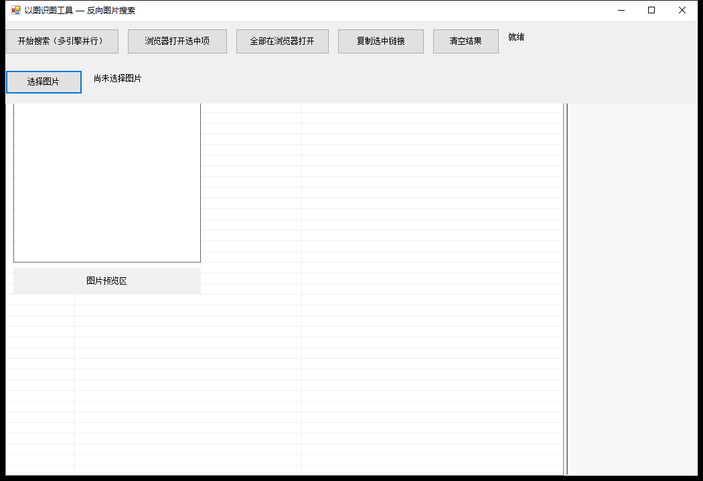

# 以图识图工具 — 反向图片搜索

用户上传一张图片，程序并行向多家互联网搜索引擎提交以图搜图，把图片的来源链接列出，并可在电脑浏览器中打开。

## 项目文件

| 文件 | 说明 |
|------|------|
| `reverse_image_search.ps1` | 核心程序（PowerShell 脚本），实现 GUI 与多引擎以图搜图 |
| `以图识图工具.bat` | 双击启动器，推荐直接使用 |

## 功能特点

- **零安装依赖**：仅需 Windows 自带的 PowerShell 5.1 + .NET Framework，无需安装 Python、Node.js 或浏览器驱动。
- **图片上传与预览**：支持 jpg / jpeg / png / gif / bmp / webp，选图后即显示预览。
- **多引擎并行搜索**：同时向 TinEye、Yandex、Bing、Google、百度、搜狗、360 七家反向图片搜索引擎提交图片，结果实时列出。
- **来源链接管理**：按“引擎 / 标题 / 链接”列出结果；支持双击、点击按钮在系统默认浏览器中打开来源页；支持全部打开、复制选中链接、清空结果。
- **操作日志**：每一步搜索进度与结果数量均记录在日志区。

## 使用方法

1. 双击 `以图识图工具.bat` 打开窗口（或直接执行 `reverse_image_search.ps1`）。
2. 点“选择图片”，挑选一张要识别的图片。
3. 点“开始搜索（多引擎并行）”，等待各引擎返回结果。
4. 在结果列表中选中一条，点“浏览器打开选中项”或直接双击，即在电脑浏览器中打开来源页面；也可点“全部在浏览器打开”或“复制选中链接”。

## ⚠️ 重要局限（必读）

- 各搜索引擎的上传接口、验证码、Cookie/签名要求会频繁变动，本程序只做“尽力而为”的页面解析，**部分引擎可能返回空结果或被拦截，无法保证找到图片的所有来源**。
- 这是反向图片搜索工具，结果以各引擎返回为准，**不等同于**精确的图片溯源或版权追溯。

## 环境要求

- Windows 7 / 10 / 11
- 系统自带 PowerShell 5.1（通常已预装）
- 能够访问互联网（各搜索引擎站点）

## 免责声明

本工具仅供个人学习和非商业用途。使用时请遵守各搜索引擎的服务条款及相关法律法规，不要用于非法用途。
